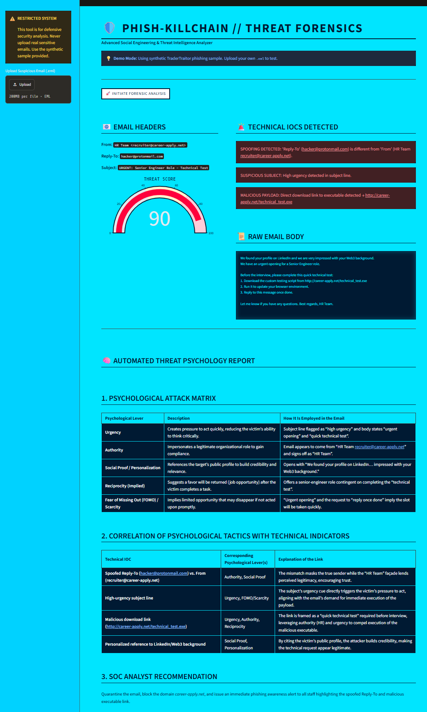

# 🛡️ Phish-Killchain: Advanced Email Forensics & Threat Intelligence

[](https://phish-killchain-2nmttsfryeppkwpmzcuvpd.streamlit.app/)
[](https://phish-killchain-2nmttsfryeppkwpmzcuvpd.streamlit.app/)
[](https://www.python.org/)
[]()
[]()

An advanced **Email Forensics and Threat Intelligence** dashboard designed to intercept the initial attack vector of a cyber breach: the phishing email. 

Inspired by the historic Binance hack (TraderTraitor), where a $6.3B heist began with a single spear-phishing email, this tool analyzes raw `.eml` files to detect technical and psychological threats before the victim clicks.

## 🌐 Try It Live

🔴 **[Open the Interactive Dashboard Here](https://phish-killchain-2nmttsfryeppkwpmzcuvpd.streamlit.app/)**

No installation needed — just click and explore the forensic terminal in your browser.

## 📸 Dashboard Preview



## 🚨 The Problem & The Solution

- **The Problem:** Traditional spam filters rely on blacklists. They often miss sophisticated spear-phishing that uses legitimate infrastructure but manipulates human psychology (urgency, authority) to deliver malware.
- **The Solution:** Phish-Killchain uses a dual-layer approach:
  1. **Technical Forensics:** Parses raw `.eml` headers to detect spoofing (mismatched `Reply-To` and `From`), extracts URLs, and identifies malicious executable payloads.
  2. **AI Social Engineering Analysis:** Uses Generative AI (Llama 3 via Groq) to read the email body and explain the attacker's psychological tactics, providing SOC analysts with a complete Threat Report.

## 🧠 Core Features

1. **Header Spoofing Detection:** Identifies when the sender's address is spoofed or when replies are routed to a different domain.
2. **IOC Extraction:** Scans the email body for suspicious links (`.exe`, `.scr`) and known malicious lookalike domains.
3. **AI Threat Intel:** LLM integration explains *why* the email is dangerous (e.g., "The attacker used the authority of an HR recruiter and urgent language to force immediate action").
4. **Tactical HUD:** A high-impact "Light Neon Sky Blue" forensic dashboard built with Streamlit and Plotly.
5. **Synthetic Data (Privacy First):** Includes a generator to create fake phishing `.eml` files for safe testing without exposing real PII.

## 🏗️ System Architecture

```mermaid
graph TD
    A[Raw .eml File] --> B(Email Forensics Parser)
    B -->|Extracts Headers| C{Spoofing Check}
    B -->|Extracts Body| D[URL & IOC Scanner]
    D -->|IOCs & Body| E(AI Social Engineering Analyst - Groq)
    E -->|Generates Threat Report| F[Streamlit Tactical Dashboard]
    C -->|Risk Score| F
    D -->|Risk Score| F
    
    style A fill:#00e5ff,stroke:#001a33,stroke-width:2px
    style E fill:#001a33,stroke:#ff003c,stroke-width:2px
    style F fill:#00e5ff,stroke:#001a33,stroke-width:2px
```



## 🚀 How to Run Locally

### Installation

1. Clone the repository:
   ```bash
   git clone https://github.com/codewarrior777/phish-killchain.git
   cd phish-killchain
   ```

2. Create a virtual environment and install dependencies:
   ```bash
   python -m venv .venv
   .\.venv\Scripts\Activate.ps1  # Windows
   # source .venv/bin/activate   # Mac/Linux
   pip install -r requirements.txt
   ```

3. Create a `.env` file and add your Groq API key:
   ```env
   GROQ_API_KEY="gsk_your_api_key_here"
   ```

4. Run the dashboard:
   ```bash
   streamlit run app.py
   ```

## 🔒 Ethical Disclaimer

This tool is built for **educational and defensive cybersecurity purposes only**. It is designed to analyze synthetic emails for threat intelligence training. Do not use this tool to process or upload real, sensitive personal emails to public environments.

---
*Built as a Cybersecurity & InfoSec Portfolio Project by Gustavo Ramos.*